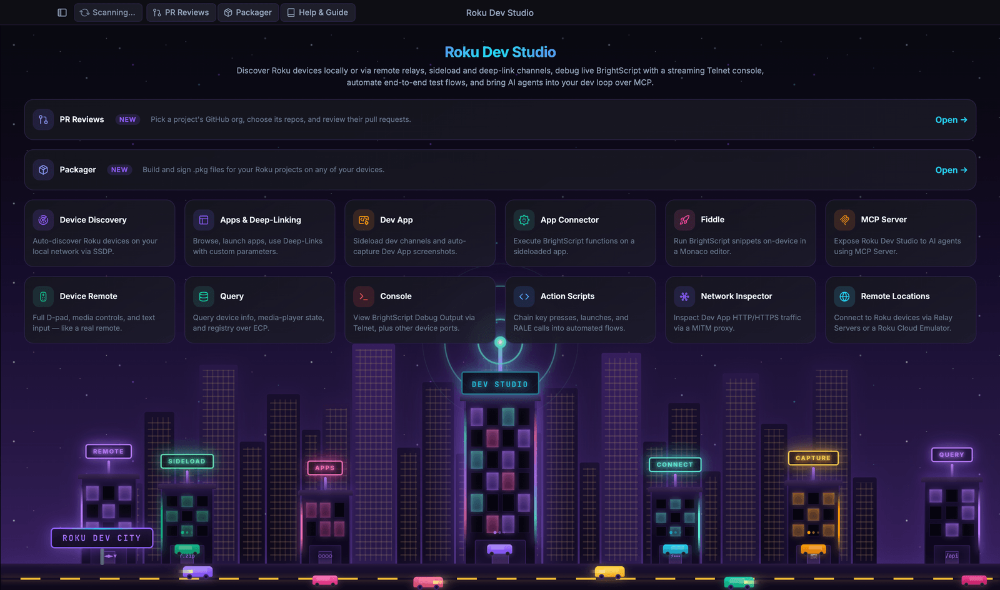
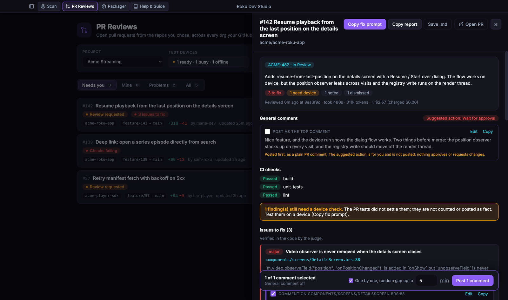
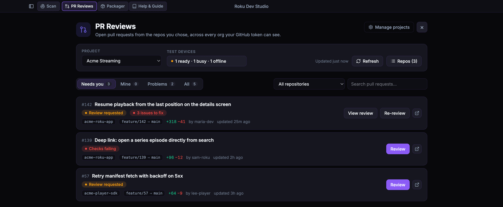
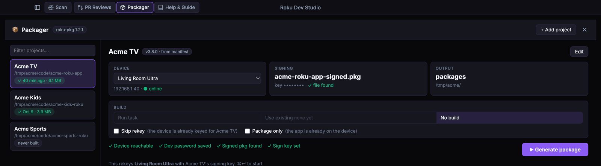
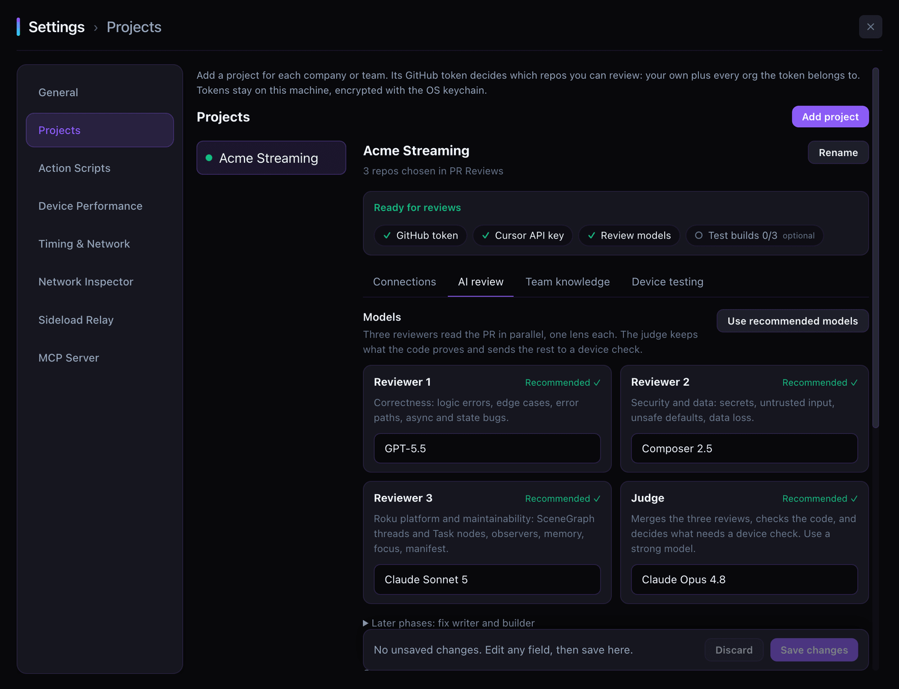

<h1>
  
  &nbsp;Roku Dev Studio
</h1>


**One desktop app for the whole Roku development loop:** drive a device, sideload, debug, inspect traffic and automate tests, then review the pull request with AI, check it on a real Roku, and package the signed build.

> **This is a fork** of [paramount-engineering/roku-dev-studio](https://github.com/paramount-engineering/roku-dev-studio) (MIT). It keeps every upstream feature and adds [AI PR reviews, device-verified testing and a Roku packager](#what-this-fork-adds). Not affiliated with or endorsed by Paramount.

[**Download**](https://github.com/jack1590/roku-dev-studio/releases/latest) · [Features](FEATURES.md) · [Install & build](INSTALLATION.md) · [MCP server](packages/roku-dev-studio-mcp/README.md) · [Changelog](CHANGELOG.md)



## Contents

- [Install](#install)
- [What this fork adds](#what-this-fork-adds)
- [Everything else it does](#everything-else-it-does)
- [Why Roku Dev Studio](#why-roku-dev-studio)
- [Projects and tokens](#projects-and-tokens)
- [Build from source](#build-from-source)
- [Repository layout](#repository-layout)
- [Glossary](#glossary)
- [License](#license)

## Install

Download the latest build from **[Releases](https://github.com/jack1590/roku-dev-studio/releases/latest)**. The app checks for updates on its own.

| Platform | File | First run |
|----------|------|-----------|
| macOS (Apple Silicon) | `.dmg` | Drag to Applications. The build is not notarized: the first time, right-click the app → **Open** → **Open**. If macOS says it is damaged, run `xattr -cr "/Applications/Roku Dev Studio.app"`. Updates on macOS show a download link instead of installing. |
| Windows | **Setup** `.exe` (or **Portable** `.exe`) | SmartScreen may warn: **More info** → **Run anyway**. |
| Linux | `.deb` or `.AppImage` | `sudo dpkg -i <file>.deb`, or `chmod +x <file>.AppImage` and run it. |

You need a Roku in [Developer Mode](https://developer.roku.com/docs/developer-program/getting-started/developer-setup.md) on your network, or a remote one through the [relay server](#remote-devices). Coming from an upstream build? Install this one once by hand; updates come from this repo after that.

## What this fork adds

Review, verify and ship Roku pull requests without leaving the app. Everything runs on your machine; tokens stay in the OS keychain.

| | |
|---|---|
| **PR Reviews** | Open PRs from every repo you pick, across all the orgs your GitHub token can see. Filter by **Needs you**, **Mine** or **Problems** (failing checks, conflicts, changes requested). |
| **AI review** | Three reviewers read the PR in parallel, one lens each (correctness, security, Roku platform). A judge merges duplicates, opens the files to verify each finding, and scores its confidence. The review is checked against the PR's JIRA ticket, linked Figma designs, CI results, the PR discussion and the repo's own standards files (`AGENTS.md`, `.cursor/rules/`, lint configs). |
| **Device checks** | When reading the code can't settle a finding, the review builds the PR, sideloads it to a Roku from a shared device pool, runs the PR's tests and reads the console. Up to 5 rounds and 30 minutes per review, both configurable. |
| **Post to GitHub** | Draft inline comments and a top comment in your team's style. Edit them, then post one by one; findings already raised in a thread become replies instead of repeats. Dismissed findings are remembered per repo. |
| **Follow-up reviews** | After new commits, only the new commits are reviewed and open findings carry over. |
| **Packager** | Build, rekey, deploy and sign a Roku package in one click with the bundled [`roku-pkg-cli`](https://github.com/jack1590/roku-pkg-cli) — nothing to install. A key mismatch offers **Rekey and try again**; run history shows why a run failed. Shares projects with the `roku-pkg` terminal CLI and devices with PR Reviews, so two runs never fight over a TV. |



| Pull requests | Packager |
|:---:|:---:|
|  |  |

The review pipeline lives in its own package, [`packages/roku-review/`](packages/roku-review/), outside the Electron code, so it can run headless later. Full tour: **[FEATURES.md → Fork features](FEATURES.md#fork-features)**.

> AI reviews use the [Cursor SDK](https://cursor.com) with your own Cursor API key; each review shows its token use and approximate cost.

## Everything else it does

All of upstream's tooling, in one window:

| Area | Highlights |
|------|------------|
| **Control** | Full remote and keyboard remote, floating mini-remote, app launcher with deep links, device queries, secret screens |
| **Sideload** | Drag-and-drop sideload, **Sideload Relay** (one push from your IDE fans out to many devices), bundled demo channel |
| **Debug** | Structured console with search and saved logs, **Console Monitor** (crash and error triage with fixes), socket **BrightScript debugger**, Ports window |
| **Inspect** | **App Connector** (call your channel's functions over RALE), **Network Inspector** (MITM proxy, traffic rules, HAR / pcap), live CPU and memory charts |
| **Automate** | **Action Scripts** builder and runner with variables, conditionals and PDF reports; `rds` CLI; **MCP server** so Cursor, Claude or VS Code can drive a real device |
| **Analyze** | Roku's `sca-cmd` static analysis with links to the certification rules, BrightScript Fiddle, log file viewer |

Every feature, with screenshots: **[FEATURES.md](FEATURES.md)**.

<a id="remote-devices"></a>

**Remote devices.** Control Rokus at other locations through the bundled relay (`npm run remote-server`, or `npm install -g roku-dev-studio-remote-server`), or start virtual devices from a Roku Cloud Emulator account. Add either from **Add Remote Location**. Setup: [remote server README](packages/roku-dev-studio-remote-server/README.md).

## Why Roku Dev Studio

Roku work is normally split across single-purpose tools that don't talk to each other. Roku Dev Studio doesn't replace Roku's protocols (ECP, RALE, telnet, `sca-cmd`); it wraps them in one GUI, one CLI and one MCP server.

| Task | Usually | Here |
|------|---------|------|
| Remote control | Roku Remote Tool, or `curl` to ECP | One tab, plus a floating mini-remote |
| Sideloading | The device's web installer, one IP at a time | **Sideload Relay**: one push installs on every targeted device |
| Debug console | `telnet <ip> 8085` | Search, filters, saved logs, crash triage |
| Debugging | One IDE's extension | Standalone debugger: breakpoints, stepping, variables, watch |
| App inspection | RALE inspects nodes only | **App Connector** calls your channel's functions and passes data both ways |
| Network traffic | Charles / mitmproxy, set up by hand | Built-in MITM proxy and packet capture |
| Repeatable tests | Hand-written scripts | **Action Scripts**, from a GUI or headless with `rds` |
| PR review | Read the diff, sideload by hand | **AI review** with a real-device check *(fork)* |
| Packaging | Device web UI or scripts | **Packager**: build, rekey, sign in one click *(fork)* |

Upstream's author on why it exists: [Beyond sideloads and telnet](https://dev.to/hdonapati/beyond-sideloads-and-telnet-killing-the-friction-in-roku-development-why-i-built-roku-dev-studio-eij).

## Projects and tokens

**Settings → Projects** holds one project per company or team, each with its own tokens. The GitHub token decides which repos you can review: your own plus every org the token's account belongs to. Pick repos in **PR Reviews**. Tokens are encrypted with the OS keychain and never written to a repo or shown again.



| Token | Create it at | Scope / notes |
|-------|--------------|---------------|
| GitHub | [github.com/settings/tokens](https://github.com/settings/tokens) | Classic token with `repo` and `read:org`, or the output of `gh auth token`. Fine-grained tokens cover one owner only, so they can't span orgs. SAML SSO orgs need the token authorized for SSO. |
| Cursor | [cursor.com/dashboard/integrations](https://cursor.com/dashboard/integrations) | API key for the review agents. |
| JIRA *(optional)* | [id.atlassian.com/…/api-tokens](https://id.atlassian.com/manage-profile/security/api-tokens) | API token, plus the site URL (`https://<site>.atlassian.net`) and account email. |
| Figma *(optional)* | [figma.com/developers/api#access-tokens](https://www.figma.com/developers/api#access-tokens) | Personal access token with only `file_content:read`. Add a file URL to test it. |

**Test** on each row checks the token and its settings. For GitHub it reports the account, how many orgs and repos it can see, and any org it had to skip.

## Build from source

Requires **Node.js 24.17+** and npm. This is an npm workspace monorepo, so run everything from the repository root.

```bash
npm install          # installs workspaces and builds the shared libraries
npm start            # builds and launches the app
npm run typecheck    # TypeScript check across every workspace
npm test             # unit tests
```

Installers: `npm run build:mac`, `build:win` or `build:linux` (platform build tools required; see **[INSTALLATION.md](INSTALLATION.md)**). Releases are built by CI from a version tag: **[RELEASE_SETUP.md](RELEASE_SETUP.md)**.

## Repository layout

| Location | What it is |
|----------|------------|
| [`apps/roku-dev-studio/`](apps/roku-dev-studio/) | The Electron app: main process, renderer, packaging |
| [`packages/roku-dev-studio-api/`](packages/roku-dev-studio-api/) | Shared Node library and the **`rds` CLI**: discovery, ECP, sideload, RALE, action scripts — [README](packages/roku-dev-studio-api/README.md) |
| [`packages/roku-dev-studio-mcp/`](packages/roku-dev-studio-mcp/) | MCP server that lets AI agents drive a Roku through the app — [README](packages/roku-dev-studio-mcp/README.md) |
| [`packages/roku-dev-studio-network-inspector/`](packages/roku-dev-studio-network-inspector/) | Network capture and MITM proxy engine — [README](packages/roku-dev-studio-network-inspector/README.md) |
| [`packages/roku-dev-studio-rce/`](packages/roku-dev-studio-rce/) | Roku Cloud Emulator client — [README](packages/roku-dev-studio-rce/README.md) |
| [`packages/roku-dev-studio-remote-server/`](packages/roku-dev-studio-remote-server/) | HTTP / WebSocket relay for remote devices — [README](packages/roku-dev-studio-remote-server/README.md) |
| [`packages/roku-dev-studio-platform/`](packages/roku-dev-studio-platform/) | Shared OS and path helpers — [README](packages/roku-dev-studio-platform/README.md) |
| [`packages/roku-review/`](packages/roku-review/) | *(fork)* AI pull request review pipeline: lenses, judge, JIRA / Figma / CI context, device checks |
| [`roku-components/`](roku-components/) | BrightScript side: `TrackerTask.xml` for App Connector, the Fiddle scaffold, the demo channel — [README](roku-components/README.md) |

<details>
<summary><b>Glossary</b></summary>

<a id="glossary"></a>

| Term | Meaning |
|------|---------|
| **ECP** | External Control Protocol: Roku's HTTP API on port `8060` (keypress, launch, query, deep link) |
| **Telnet 8085 / 8080** | The BrightScript debug console (`8085`) and developer system commands (`8080`) |
| **RALE** | Roku Advanced Layout Editor protocol (default port `49200`), spoken by the `TrackerTask` component |
| **TrackerTask** | The component you add to a channel to reach it from RALE / App Connector — [guide](roku-components/README.md) |
| **App Connector** | The tab that talks RALE: call your channel's exposed functions, look up nodes, edit the registry |
| **Sideload Relay** | The app advertises itself as a Roku, so one sideload from your IDE fans out to many devices |
| **Action Script** | JSON automation that chains keypresses, queries, sideloads, App Connector calls, screenshots, conditions and waits |
| **MCP server** | Model Context Protocol server that lets Cursor, Claude Desktop or VS Code drive a device while the app is open |
| **Judge** | *(fork)* The review agent that merges the reviewers' findings, verifies them in the code and decides what needs a device check |
| **Device pool** | *(fork)* The test Rokus shared by PR Reviews and the Packager; a device runs one job at a time |
| **`rds`** | The terminal CLI from `roku-dev-studio-api` (`rds discover`, `rds keypress`, `rds script run`, …) |

</details>

## License

[MIT](LICENSE). Original work © Paramount Streaming (Hareendra Donapati); fork additions maintained by [jack1590](https://github.com/jack1590).

<details>
<summary><b>Third-party components</b></summary>

| Library | Purpose | Licence |
|---------|---------|---------|
| [@cursor/sdk](https://cursor.com) | AI review agents *(fork)* | Proprietary, [Cursor Terms of Service](https://cursor.com/terms-of-service) |
| [roku-pkg-cli](https://github.com/jack1590/roku-pkg-cli) | Packager build, rekey and signing *(fork)* | [MIT](https://opensource.org/licenses/MIT) |
| [@tanstack/virtual-core](https://tanstack.com/virtual) | Virtualized lists (console, large results) | [MIT](https://opensource.org/licenses/MIT) |
| [archiver](https://github.com/archiverjs/node-archiver) | Building sideload `.zip` packages | [MIT](https://opensource.org/licenses/MIT) |
| [brighterscript](https://github.com/rokucommunity/brighterscript) | BrightScript linting in the Fiddle editor | [MIT](https://opensource.org/licenses/MIT) |
| [commander](https://github.com/tj/commander.js) | `rds` CLI argument parsing | [MIT](https://opensource.org/licenses/MIT) |
| [electron](https://www.electronjs.org/) | Desktop runtime | [MIT](https://opensource.org/licenses/MIT) |
| [electron-builder](https://www.electron.build/) | Packaging and installers | [MIT](https://opensource.org/licenses/MIT) |
| [electron-updater](https://www.electron.build/auto-update) | In-app updates | [MIT](https://opensource.org/licenses/MIT) |
| [form-data](https://github.com/form-data/form-data) | HTTP multipart uploads | [MIT](https://opensource.org/licenses/MIT) |
| [modern-screenshot](https://github.com/qq15725/modern-screenshot) | DOM-to-image capture for chart cards and PDF export | [MIT](https://opensource.org/licenses/MIT) |
| [monaco-editor](https://microsoft.github.io/monaco-editor/) | Code editor (Fiddle, action-script steps) | [MIT](https://opensource.org/licenses/MIT) |
| [pdf-lib](https://pdf-lib.js.org/) | PDF generation | [MIT](https://opensource.org/licenses/MIT) |
| [sharp](https://sharp.pixelplumbing.com/) | Image processing (icons, build) | [Apache-2.0](https://opensource.org/licenses/Apache-2.0) |
| [solid-js](https://www.solidjs.com/) | Reactive framework for the new renderer | [MIT](https://opensource.org/licenses/MIT) |
| [ws](https://github.com/websockets/ws) | WebSocket client | [MIT](https://opensource.org/licenses/MIT) |

Their dependencies are used under the terms declared in `package-lock.json` and each package's repository.

</details>
